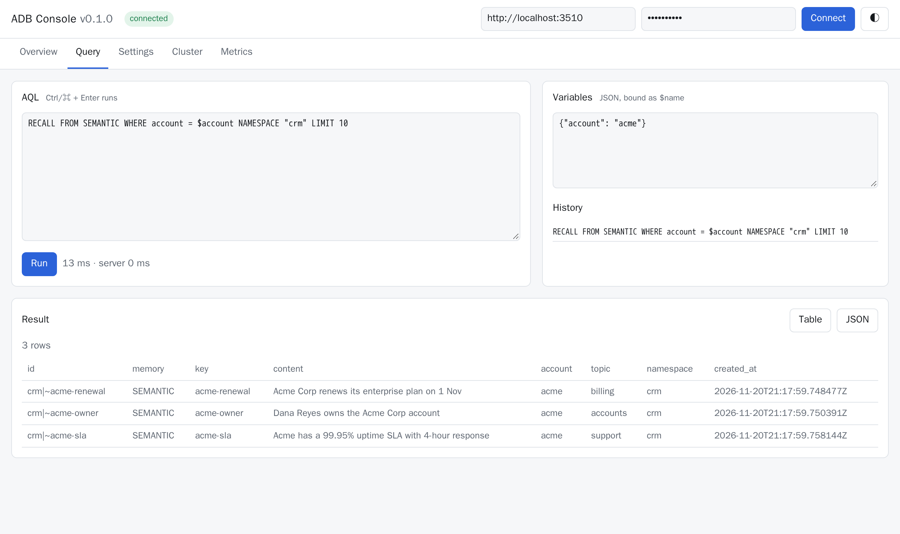
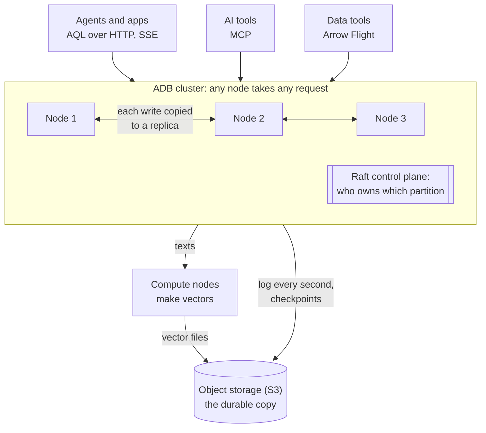
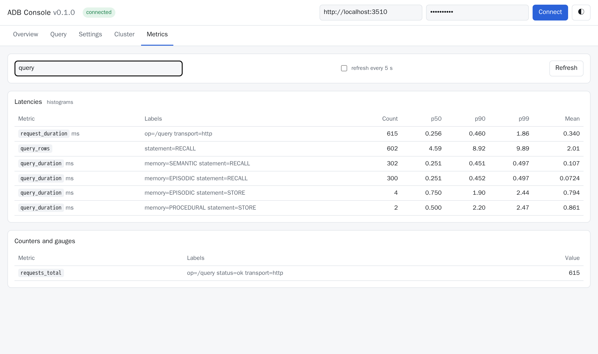

# ADB: the database for AI agent memory

ADB gives AI agents a long-term memory they can query: what happened, what is true,
how to do things, and what they are working on now. Agents talk to it in **AQL**, a
small query language that says what the agent wants. They can also use it through
**MCP** without writing any code. It runs as one binary on a laptop, or as a
cluster on object storage.

[](LICENSE)
[](https://a3t-ai.github.io/AQL)



## Why ADB

An agent forgets everything outside its context window. To give it a memory, teams
usually stitch several systems together:
- a vector database for similarity search;
- Postgres for facts;
- Redis for the current task;
- a queue for events;
- sometimes a graph store.

Then they write the glue between them. Every agent ends up with its own version of
"memory". Nothing stays consistent across those systems. A deleted fact can still
come back from one of them, and nobody can say what an agent knew at a given moment.

ADB is one database built for this job:

- **Memory types built in.** `WORKING` is the current task, `EPISODIC` is what
  happened, `SEMANTIC` is facts, `PROCEDURAL` is how to do things, and `TOOLS` is
  what an agent can use. Each type has the behaviour it needs, and they share one
  query language.
- **One query for meaning, filters and relations.** Similarity search (`LIKE`),
  field filters, ordering, aggregates and graph links (`LINK`, `FOLLOW LINKS`) work
  together in one AQL statement. There's no second system to keep in sync.
- **Forget means forget.** `FORGET` records a tombstone that every later read
  respects, on every node. Nothing is physically deleted until an explicit purge, so
  there is an audit trail of what was removed and when.
- **Live memory.** `SUBSCRIBE` keeps a query's result current and streams topic
  messages over server-sent events. Agents react to changes instead of polling.
- **Safe experiments.** Namespaces keep one agent's or tenant's memory apart.
  `BRANCH`, `FORK` and `MERGE` let an agent try changes on a copy and merge them back.
- **Works with any agent.** ADB has a built-in MCP server for Claude Code, Claude
  Desktop and other MCP clients, AQL over HTTP, and Arrow Flight for bulk data.
- **Embeddings your way.** Use the built-in local model, OpenAI, or any
  OpenAI-compatible endpoint, and switch at runtime. Vectors are made in the
  background, optionally on separate compute nodes, so writes never wait for a model.
- **Small to large.** A single node keeps data in a local directory. A cluster keeps
  data on S3, so nodes need only small disks, and you add nodes to scale.

## Quick start

**1. Build.** You need stable Rust and `protoc` (`apt install protobuf-compiler`).
There are no prebuilt binaries yet.

```bash
git clone https://github.com/a3t-ai/ADB && cd ADB
cargo build --release -p adb-cli --features console
```

Or with Docker:
`docker build -t adb --build-arg ADB_FEATURES=console .`

**2. Run.**

```bash
./target/release/adb serve-http --data-dir ./adb-data
```

ADB now serves HTTP and MCP on port 3000 and Arrow Flight on 3001. Open
**http://localhost:3000/ui** for the console.

**3. Give an agent some memory.** Type these into the console's Query tab, or send
them to `POST /query`:

```sql
-- facts, events and a procedure, each in its namespace
STORE INTO SEMANTIC (key = "acme-renewal", content = "Acme renews its enterprise plan on 1 Nov", account = "acme") NAMESPACE "crm"
STORE INTO EPISODIC (key = "inc-2041", content = "Checkout pods were OOMKilled during the sale", service = "payments", severity = 2) NAMESPACE "ops"
STORE INTO PROCEDURAL (key = "oom-fix", content = "Raise the worker memory limit to 2 GiB and restart the pool") NAMESPACE "ops"

-- by meaning, by field, by text
RECALL FROM SEMANTIC LIKE "when does acme renew" NAMESPACE "crm" LIMIT 3
RECALL FROM EPISODIC WHERE content CONTAINS "OOMKilled" ORDER BY severity DESC LIMIT 5 NAMESPACE "ops"

-- relate memories, then walk the relation
LINK FROM PROCEDURAL WHERE key = "oom-fix" INTO EPISODIC WHERE key = "inc-2041" TYPE "fixed" WEIGHT 0.9 NAMESPACE "ops"
RECALL FROM EPISODIC WHERE key = "inc-2041" NAMESPACE "ops" FOLLOW LINKS DEPTH 1

-- try a change on a branch, then merge it
BRANCH FROM "crm" INTO "crm-try"
UPDATE INTO SEMANTIC WHERE key = "acme-renewal" (content = "Acme renews on 15 Nov") NAMESPACE "crm-try"
MERGE FROM "crm-try" INTO "crm"

-- forget, for every later read
FORGET FROM SEMANTIC WHERE key = "acme-renewal" NAMESPACE "crm"
```

The same from a shell:

```bash
curl -s localhost:3000/query -H 'Content-Type: application/json' \
  -d '{"query": "RECALL FROM EPISODIC LIKE $q NAMESPACE \"ops\" LIMIT 3", "variables": {"q": "pods ran out of memory"}}'
```

**4. Connect an agent over MCP.** For example, Claude Code:

```bash
claude mcp add adb -- /path/to/adb serve --data-dir ~/.adb
```

The agent now has `remember`, `recall`, `forget`, `link`, `watch` and `aql_query`
as tools.

Similarity search needs an embedding model. Download the local one with
`tests/fetch-model.sh <dir>` and set `ADB_EMBED_MODEL_DIR=<dir>`, or switch to
OpenAI in the console's Settings tab. The full language is in the
[AQL repo](https://github.com/a3t-ai/AQL), and you can try it in the browser in the
[AQL playground](https://a3t-ai.github.io/AQL).

## How it works



- **Partitions.** Memory is split into partitions (64 by default). Each namespace
  lives in one partition. Each partition has one owner node, and any node accepts a
  request and forwards it to the owner.
- **Writes.** The owner sends each write to a second node, the replica. It
  acknowledges the write once both nodes hold it in memory. Every second, the log
  goes to object storage as a small segment. Tables are checkpointed there too.
- **Object storage holds the data.** S3, or any S3-compatible store, keeps the one
  durable copy. Nodes keep only recent and hot data on local disk, so disks stay
  small and a new node needs no full copy.
- **Failover.** A small Raft group decides only who owns which partition. If an
  owner dies, its replica takes over with every acknowledged write. If both die,
  another node rebuilds the partition from object storage. In that case it can lose
  at most the last second of writes.
- **Reads.** The owner and the replica both serve reads. Hot data is answered from
  a memory cache. Storage is columnar ([Lance](https://github.com/lancedb/lance)),
  queried with [Apache DataFusion](https://datafusion.apache.org).
- **Vectors.** Making vectors is kept off the write path. The node, or a separate
  compute node, writes them to object storage as files.
- **A single node** is the same engine without the cluster parts: data in
  `--data-dir`, each write acknowledged after it reaches the disk.

## ADB Console (web UI)

A web UI built into the binary. It has no other dependencies and works offline.
Open `http://<node>:3000/ui`, and paste the node's token if it has one.

| Overview | Cluster |
|---|---|
|  |  |
| **Settings** | **Metrics** |
|  |  |

- **Overview:** health, every connection point of the node, and ready-to-copy
  snippets for curl, MCP, Python and the CLI.
- **Query:** an AQL editor with variables and history, shown at the top of this page.
- **Settings:** the embedding provider and hot cache rules.
- **Cluster:** nodes and which node owns each partition.
- **Metrics:** latency percentiles and counters.

The console is a build feature (`--features console`). A binary built without it
serves no UI.

## Performance

These numbers were measured on 20 Nov 2026 on a 3-node cluster on Hetzner Cloud:
- **Database nodes:** 3 × CCX33, each with 8 dedicated vCPUs and 32 GB RAM.
- **Compute nodes:** 2 × CCX33 making vectors with the local model.
- **Storage:** Hetzner Object Storage.
- **Load:** 4 load-generator machines sending 1,024 concurrent requests in total,
  spread over 64 namespaces, for 20 seconds per test.

| Operation | Throughput | p50 | p99 |
|---|---:|---:|---:|
| `RECALL` by key (WORKING) | 105,000 /s | 2.8 ms | 82 ms |
| `RECALL` by key (SEMANTIC) | 103,000 /s | 2.7 ms | 88 ms |
| `RECALL` newest 10 episodes | 53,000 /s | 2.7 ms | 198 ms |
| `RECALL … AGGREGATE COUNT` by field | 49,000 /s | 3.0 ms | 126 ms |
| `RECALL WHERE` field `LIMIT 10` | 29,000 /s | 3.4 ms | 165 ms |
| `STORE` (WORKING) | 17,000 /s | 39 ms | 395 ms |
| `STORE` (SEMANTIC, vectors made on compute nodes) | 16,800 /s | 41 ms | 406 ms |
| `UPDATE` (SEMANTIC) | 13,800 /s | 52 ms | 395 ms |
| Mixed: 70% reads, 25% `STORE`, 5% `UPDATE` | 16,000 /s | 27 ms | 963 ms |
| `FORGET` (one key each) | 1,900 /s | 399 ms | 2,065 ms |

- Writes are acknowledged once they are in memory on two nodes, and they reach
  object storage within a second.
- `FORGET` is slow today because each one reads the record's earlier versions
  first. A faster tombstone path is being built.
- In an earlier run on the same hardware, going from 3 to 5 nodes raised writes
  1.5–1.6× and reads 1.3–1.4×.
- The load generator is [`tests/perf-remote.mjs`](tests/perf-remote.mjs).

## Connect

| Protocol | Where | Use it for |
|---|---|---|
| AQL over HTTP | `POST :3000/query` | Any AQL statement, JSON in and out |
| Live updates (SSE) | `GET :3000/subscriptions/:id/events`, `/watches/:id/events` | Topic messages and query results kept current |
| MCP | `http://:3000/mcp`, or `adb serve` on stdio | Agents and AI tools |
| Arrow Flight | `grpc://:3001` | Bulk reads and writes as Arrow, SQL, AQL |
| CLI | `adb sql`, `adb query` | One statement from a shell |
| Health and metrics | `/health`, `/metrics` (Prometheus) | Probes and monitoring |

Examples for each, including Python over Flight and the MCP setup for each client,
are in **[docs/connect.md](docs/connect.md)**.

## Configure

| Setting | What it controls |
|---|---|
| `--data-dir`, `--port`, `--flight-port`, `--host` | Where data lives and where ADB listens |
| `ADB_AUTH_TOKEN`, `ADB_SCOPED_TOKENS` | One token for everything, or tokens limited to certain namespaces |
| `ADB_COLD_URI` + `AWS_*` | Object storage (required for a cluster) |
| `PUT /admin/embedding` | The embedding provider (local, OpenAI, custom), applied without a restart |
| `ADB_NODE_ID`, `ADB_CONTROL_PEERS`, … | Running a cluster ([Kubernetes manifests](deploy/k8s)) |

Every setting, with examples, is in **[docs/configuration.md](docs/configuration.md)**.

## Build and test

```bash
cargo build --release                       # target/release/adb
cargo test --workspace                      # unit, HTTP and MCP tests
node ../AQL/tests/run-tests.mjs --url http://localhost:3000   # AQL conformance against an empty node
node tests/mcp-smoke.mjs --stdio target/release/adb          # an MCP session end to end
```

To develop against a local AQL checkout next to this one (`../AQL`), copy
`.cargo/config.toml.example` to `.cargo/config.toml`.

## Licence

ADB is licensed under the [Elastic License 2.0](LICENSE) (ELv2). You may use, copy,
modify and distribute it, including in production and in your own products. You may
not:
- provide ADB to others as a hosted or managed service;
- circumvent licence-key functionality;
- remove licensing notices.

See [NOTICE](NOTICE) for third-party code: `third_party/lance` is a modified copy of
Lance under the Apache License 2.0.
