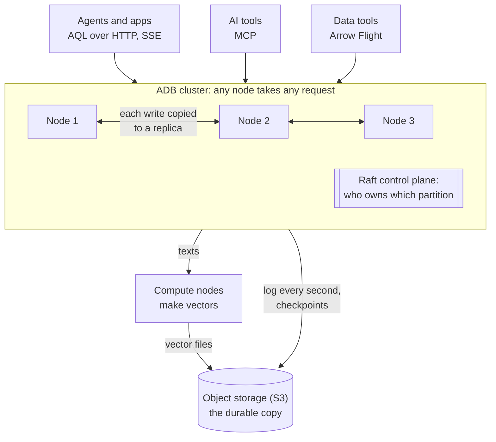
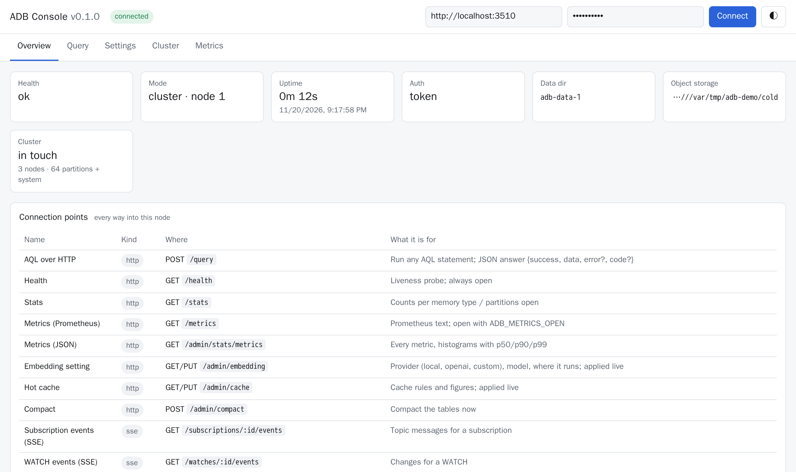
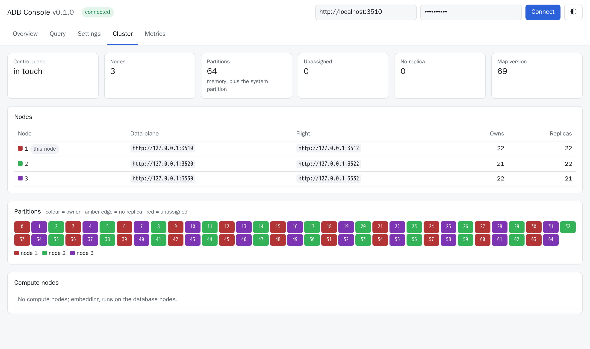
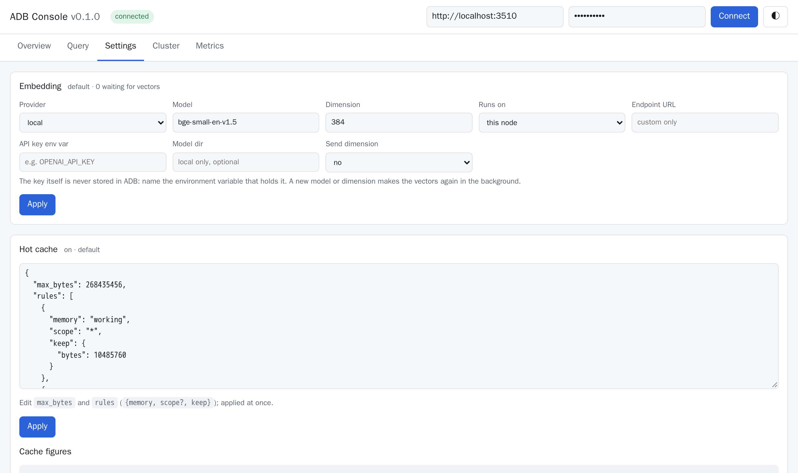

# ADB: one database for everything an AI agent remembers

**An agent is only as good as its memory. Today that memory is stitched together
from half a dozen databases. ADB replaces them with one, and a query language agents can
actually speak.**

[](#status)
[](https://github.com/a3t-ai/ADB/releases)
[](LICENSE)
[](https://a3t-ai.github.io/AQL)

> [!WARNING]
> **Not for production.** ADB is a pre-release (v0.1.0). AQL, the APIs and the
> on-disk format can still change, and data written by one version may not be
> readable by the next. Use it to build and try things, not to hold data you can't
> recreate.

## The problem: agent memory is not one kind of data

In a single turn, an agent asks its memory several very different questions:

| The agent asks | What it needs | What teams use today |
|---|---|---|
| *Have we seen something like this before?* | Similarity over text | A vector database |
| *What do we know about Acme?* | Exact facts and fields | Postgres or a document store |
| *What fixed it last time?* | Relations between memories | A graph database |
| *What happened in the last hour?* | Events in time order | An event log or time-series store |
| *What am I working on right now?* | Fast, short-lived state | Redis |
| *Tell me when something changes.* | Subscriptions | A message queue |
| *Can I try this without breaking what users see?* | A safe copy of memory | Copy the database, or hope |

No single database answers all of these, so every team builds the same thing: a
stack of systems and the glue between them. That costs them in six ways:

- **Slow turns.** One agent step becomes several network round trips in several
  query languages, and the agent waits for each one.
- **Memory that disagrees with itself.** There is no shared transaction. A fact
  updated in Postgres is still stale in the vector index, and the graph still points
  at a record that was deleted.
- **Forgetting that doesn't work.** Delete a memory in one store and it comes back
  from another. That's a real problem when a user asks to be forgotten.
- **No safe way to experiment.** A new prompt, a new plan or a bulk import writes
  straight into the memory every user depends on. Undoing a bad import means
  restoring a backup.
- **Isolation by convention.** Agents and tenants are kept apart by a `tenant_id`
  column in every store, so one missed filter leaks memory across customers.
  Permissions, backups and audit have to be built once per store, by every team.

## The solution: ADB, a multi-model memory database

ADB is a database built only for agent memory. Vectors, facts, graph links, events,
working state and subscriptions live in **one engine**. They share one ordered log,
one set of namespaces, one permission model and one query language. Each kind of
memory is a built-in **memory type** with the indexes it needs:

| The agent asks | In ADB |
|---|---|
| *Have we seen something like this before?* | `RECALL FROM EPISODIC LIKE "pods running out of memory"` |
| *What do we know about Acme?* | `RECALL FROM SEMANTIC WHERE account = "acme"` |
| *What fixed it last time?* | `RECALL FROM EPISODIC WHERE key = "inc-2041" FOLLOW LINKS TYPE "fixed"` |
| *What happened, most severe first?* | `RECALL FROM EPISODIC WHERE service = "payments" ORDER BY severity DESC` |
| *What am I working on right now?* | `RECALL FROM WORKING WINDOW LAST 30m` |
| *Tell me when something changes.* | `SUBSCRIBE RECALL FROM SEMANTIC WHERE account = "acme"` |
| *Can I try this without breaking what users see?* | `BRANCH FROM "support-agent" INTO "support-agent-try"` |

Because it is one engine, the six problems go away:

- **One request, one round trip.** A single statement can find memories by meaning
  and then walk the graph from them. That's work that used to take three systems.
- **Memory stays consistent.** Every change goes through one ordered log, so every
  index is built from the same history. Vectors follow a moment later, in the
  background.
- **Forget means forget.** `FORGET` removes a memory from similarity search, field
  filters, graph walks and subscriptions in the same instant, on every node. It's
  kept as a tombstone with an audit trail until an explicit purge.
- **Branch and merge memory like code.** Try a change on a branch that copies
  nothing, then merge it or drop it. You can also branch from any point in the past.
  See [below](#branch-merge-and-isolate-memory-like-code).
- **Isolation built in.** Every memory lives in a namespace, and a token can be
  limited to the namespaces it may read or write. The database enforces the walls
  between agents and tenants; it's no longer a filter every query must remember.

## AQL: say what the agent wants, not how to find it

AQL has thirteen verbs that work the same on every memory type. There are no tables,
indexes or joins to choose: `RECALL`, `STORE`, `UPDATE`, `FORGET`, `LINK`, `UNLINK`,
`BRANCH`, `FORK`, `MERGE`, `PIPELINE`, `SUBSCRIBE`, `UNSUBSCRIBE`, `PUBLISH`. A
statement reads like the agent's intent. ADB picks the vector, field, key, recency
or graph index. That also makes AQL easy for an LLM to write correctly.

*"How did we fix incidents like this one?"* Without ADB:

```python
hits  = vector_db.query(embed("pods running out of memory"), top_k=5, filter={"ns": "ops"})
rows  = postgres.execute("SELECT * FROM incidents WHERE id = ANY(%s)", [h.id for h in hits])
fixes = graph.run("MATCH (i:Incident)<-[:FIXED]-(p:Procedure) WHERE i.id IN $ids RETURN p",
                  ids=[r.id for r in rows])
```

With ADB, one statement:

```sql
RECALL FROM EPISODIC LIKE "pods running out of memory" NAMESPACE "ops" LIMIT 5 FOLLOW LINKS TYPE "fixed" DEPTH 1
```

It finds the similar incidents and returns the procedures that fixed them.

**And it fits the way agents work:**
- **Built-in MCP server.** Claude Code, Claude Desktop and any other MCP client get
  memory tools with no code.
- **AQL over HTTP and Arrow Flight** for applications and data tools.
- **Embeddings your way.** Use the local model, OpenAI or your own endpoint, and
  switch at runtime. Vectors are made in the background, so writes never wait.
- **A web console** in the binary.
- **Scales from a laptop to a cluster.** One binary runs a single node on a
  laptop, or a cluster that keeps its data on S3 and scales by adding nodes.


## Branch, merge and isolate memory, like code

Agents learn by trying. A new prompt, a new plan or a bulk import shouldn't write
straight into the memory every user depends on. ADB treats memory the way git treats
code:

```sql
-- try a change without touching what users see
BRANCH FROM "support-agent" INTO "support-agent-try"
UPDATE INTO SEMANTIC WHERE key = "tone" (content = "Answer casually") NAMESPACE "support-agent-try"

-- keep it: merge back. A record changed on both sides is a conflict, unless you say who wins
MERGE FROM "support-agent-try" INTO "support-agent" PREFER SOURCE

-- or throw it away
FORGET FROM ALL NAMESPACE "support-agent-try"

-- go back to before a bad import
BRANCH FROM "support-agent" INTO "support-agent-clean" AS OF "2026-11-20T09:00:00Z"

-- a full, independent copy, for an evaluation run
FORK FROM "support-agent" INTO "support-agent-eval"
```

- **Branches copy nothing.** A branch reads its base as it was at the branch point,
  plus its own changes. Its changes stay in the branch, and later changes to the
  base don't leak in. So a branch per experiment, per session or per evaluation is
  cheap.
- **Merges are explicit.** If the same record changed on both sides, `MERGE` stops
  and lists the conflicts, unless `PREFER SOURCE` or `PREFER TARGET` says which side
  wins. Merging the base into a branch brings the branch up to date.
- **Time travel.** `AS OF` branches from any moment in the past, for example from
  just before a bad import.
- **Forgetting still reaches everything.** A `FORGET` in the base also removes the
  memory from its branches, so deleted data doesn't survive inside an old
  experiment. A `FORK` is a separate copy with its own life.
- **Isolation.** Namespaces are the unit of separation. You decide what a namespace
  is: one per agent, user, tenant or session. A scoped token can be limited to the
  namespaces it may read or write (for example `acme-*`). Every statement it sends
  must name a namespace it covers, and it can't reach admin endpoints or other
  tenants' memory.

## Quick start

**1. Run ADB.** Pick one.

With Docker (Linux x86_64 and arm64, or Docker Desktop on a Mac). The image has the
console and the embedding model built in:

```bash
docker run -d --name adb -p 3000:3000 -p 3001:3001 -v adb-data:/data ghcr.io/a3t-ai/adb:0.1.0
```

Or download a binary from [Releases](https://github.com/a3t-ai/ADB/releases). There
are builds for Linux x86_64 and arm64 (glibc 2.35+: Ubuntu 22.04+, Debian 12+) and
macOS on Apple silicon:

```bash
curl -fsSL -O https://github.com/a3t-ai/ADB/releases/download/v0.1.0/adb-v0.1.0-linux-x86_64.tar.gz
tar -xzf adb-v0.1.0-linux-x86_64.tar.gz
./adb/adb serve-http --data-dir ./adb-data
```

Or build from source. You need stable Rust and `protoc`
(`apt install protobuf-compiler`):

```bash
git clone https://github.com/a3t-ai/ADB && cd ADB
cargo build --release -p adb-cli --features console
./target/release/adb serve-http --data-dir ./adb-data
```

**2. Open the console** at **http://localhost:3000/ui**. ADB serves HTTP and MCP on
port 3000 and Arrow Flight on 3001. To require a token, add
`-e ADB_AUTH_TOKEN=<secret>` to `docker run`, or set `ADB_AUTH_TOKEN` before
starting the binary.

**3. Give an agent some memory.** Type these into the console's Query tab, or send
them to `POST /query`:

```sql
-- facts, events and a procedure, each in its namespace
STORE INTO SEMANTIC (key = "acme-renewal", content = "Acme renews its enterprise plan on 1 Nov", account = "acme") NAMESPACE "crm"
STORE INTO EPISODIC (key = "inc-2041", content = "Checkout pods were OOMKilled during the sale", service = "payments", severity = 2) NAMESPACE "ops"
STORE INTO PROCEDURAL (key = "oom-fix", content = "Raise the worker memory limit to 2 GiB and restart the pool") NAMESPACE "ops"

-- by meaning, by field, by text
RECALL FROM SEMANTIC LIKE "when does acme renew" NAMESPACE "crm" LIMIT 3
RECALL FROM EPISODIC WHERE content CONTAINS "OOMKilled" ORDER BY severity DESC LIMIT 5 NAMESPACE "ops"

-- relate memories, then walk the relation
LINK FROM PROCEDURAL WHERE key = "oom-fix" INTO EPISODIC WHERE key = "inc-2041" TYPE "fixed" WEIGHT 0.9 NAMESPACE "ops"
RECALL FROM EPISODIC WHERE key = "inc-2041" NAMESPACE "ops" FOLLOW LINKS DEPTH 1

-- try a change on a branch, then merge it
BRANCH FROM "crm" INTO "crm-try"
UPDATE INTO SEMANTIC WHERE key = "acme-renewal" (content = "Acme renews on 15 Nov") NAMESPACE "crm-try"
MERGE FROM "crm-try" INTO "crm"

-- forget, for every later read
FORGET FROM SEMANTIC WHERE key = "acme-renewal" NAMESPACE "crm"
```

The same from a shell:

```bash
curl -s localhost:3000/query -H 'Content-Type: application/json' \
  -d '{"query": "RECALL FROM EPISODIC LIKE $q NAMESPACE \"ops\" LIMIT 3", "variables": {"q": "pods ran out of memory"}}'
```

**4. Connect an agent over MCP.** For example, Claude Code, to the running ADB:

```bash
claude mcp add --transport http adb http://localhost:3000/mcp
```

or, with the binary, as a local process (no server needed):
`claude mcp add adb -- /path/to/adb serve --data-dir ~/.adb`.

The agent now has `remember`, `recall`, `forget`, `link`, `watch` and `aql_query`
as tools.

The Docker image has the embedding model built in. With a binary, similarity
search needs the model: download it with `tests/fetch-model.sh <dir>` from this repo
and set `ADB_EMBED_MODEL_DIR=<dir>`, or switch to OpenAI in the console's Settings
tab. The full language is in the
[AQL repo](https://github.com/a3t-ai/AQL), and you can try it in the browser in the
[AQL playground](https://a3t-ai.github.io/AQL).

## How it works



- **Partitions.** Memory is split into partitions (64 by default). Each namespace
  lives in one partition. Each partition has one owner node, and any node accepts a
  request and forwards it to the owner.
- **Writes.** The owner sends each write to a second node, the replica. It
  acknowledges the write once both nodes hold it in memory. Every second, the log
  goes to object storage as a small segment. Tables are checkpointed there too.
- **Object storage holds the data.** S3, or any S3-compatible store, keeps the one
  durable copy. Nodes keep only recent and hot data on local disk, so disks stay
  small and a new node needs no full copy.
- **Failover.** A small Raft group decides only who owns which partition. If an
  owner dies, its replica takes over with every acknowledged write. If both die,
  another node rebuilds the partition from object storage. In that case it can lose
  at most the last second of writes.
- **Reads.** The owner and the replica both serve reads. Hot data is answered from
  a memory cache. Storage is columnar ([Lance](https://github.com/lancedb/lance)),
  queried with [Apache DataFusion](https://datafusion.apache.org).
- **Vectors.** Making vectors is kept off the write path. The node, or a separate
  compute node, writes them to object storage as files.
- **A single node** is the same engine without the cluster parts: data in
  `--data-dir`, each write acknowledged after it reaches the disk.

## ADB Console (web UI)

A web UI built into the binary. It has no other dependencies and works offline.
Open `http://<node>:3000/ui`, and paste the node's token if it has one.

| Overview | Cluster |
|---|---|
|  |  |
| **Settings** | **Metrics** |
|  |  |

- **Overview:** health, every connection point of the node, and ready-to-copy
  snippets for curl, MCP, Python and the CLI.
- **Query:** an AQL editor with variables and history, shown at the top of this page.
- **Settings:** the embedding provider and hot cache rules.
- **Cluster:** nodes and which node owns each partition.
- **Metrics:** latency percentiles and counters.

The console is a build feature (`--features console`). A binary built without it
serves no UI.

## Performance

These numbers were measured on 20 Nov 2026 on a 3-node cluster on Hetzner Cloud:
- **Database nodes:** 3 × CCX33, each with 8 dedicated vCPUs and 32 GB RAM.
- **Compute nodes:** 2 × CCX33 making vectors with the local model.
- **Storage:** Hetzner Object Storage.
- **Load:** 4 load-generator machines sending 1,024 concurrent requests in total,
  spread over 64 namespaces, for 20 seconds per test.

| Operation | Throughput | p50 | p99 |
|---|---:|---:|---:|
| `RECALL` by key (WORKING) | 105,000 /s | 2.8 ms | 82 ms |
| `RECALL` by key (SEMANTIC) | 103,000 /s | 2.7 ms | 88 ms |
| `RECALL` newest 10 episodes | 53,000 /s | 2.7 ms | 198 ms |
| `RECALL … AGGREGATE COUNT` by field | 49,000 /s | 3.0 ms | 126 ms |
| `RECALL WHERE` field `LIMIT 10` | 29,000 /s | 3.4 ms | 165 ms |
| `STORE` (WORKING) | 17,000 /s | 39 ms | 395 ms |
| `STORE` (SEMANTIC, vectors made on compute nodes) | 16,800 /s | 41 ms | 406 ms |
| `UPDATE` (SEMANTIC) | 13,800 /s | 52 ms | 395 ms |
| Mixed: 70% reads, 25% `STORE`, 5% `UPDATE` | 16,000 /s | 27 ms | 963 ms |
| `FORGET` (one key each) | 1,900 /s | 399 ms | 2,065 ms |

- Writes are acknowledged once they are in memory on two nodes, and they reach
  object storage within a second.
- `FORGET` is slow today because each one reads the record's earlier versions
  first. A faster tombstone path is being built.
- In an earlier run on the same hardware, going from 3 to 5 nodes raised writes
  1.5–1.6× and reads 1.3–1.4×.
- The load generator is [`tests/perf-remote.mjs`](tests/perf-remote.mjs).

## Connect

| Protocol | Where | Use it for |
|---|---|---|
| AQL over HTTP | `POST :3000/query` | Any AQL statement, JSON in and out |
| Live updates (SSE) | `GET :3000/subscriptions/:id/events`, `/watches/:id/events` | Topic messages and query results kept current |
| MCP | `http://:3000/mcp`, or `adb serve` on stdio | Agents and AI tools |
| Arrow Flight | `grpc://:3001` | Bulk reads and writes as Arrow, SQL, AQL |
| CLI | `adb sql`, `adb query` | One statement from a shell |
| Health and metrics | `/health`, `/metrics` (Prometheus) | Probes and monitoring |

Examples for each, including Python over Flight and the MCP setup for each client,
are in **[docs/connect.md](docs/connect.md)**.

## Configure

| Setting | What it controls |
|---|---|
| `--data-dir`, `--port`, `--flight-port`, `--host` | Where data lives and where ADB listens |
| `ADB_AUTH_TOKEN`, `ADB_SCOPED_TOKENS` | One token for everything, or tokens limited to certain namespaces |
| `ADB_COLD_URI` + `AWS_*` | Object storage (required for a cluster) |
| `PUT /admin/embedding` | The embedding provider (local, OpenAI, custom), applied without a restart |
| `ADB_NODE_ID`, `ADB_CONTROL_PEERS`, … | Running a cluster ([Kubernetes manifests](deploy/k8s)) |

Every setting, with examples, is in **[docs/configuration.md](docs/configuration.md)**.

## Build and test

```bash
cargo build --release                       # target/release/adb
cargo test --workspace                      # unit, HTTP and MCP tests
node ../AQL/tests/run-tests.mjs --url http://localhost:3000   # AQL conformance against an empty node
node tests/mcp-smoke.mjs --stdio target/release/adb          # an MCP session end to end
```

To develop against a local AQL checkout next to this one (`../AQL`), copy
`.cargo/config.toml.example` to `.cargo/config.toml`.

## Status

ADB is a pre-release and **not for production**. It has been benchmarked and tested
for failover on real clusters, but AQL, the APIs and the on-disk format can still
change between versions, with no migration from one to the next yet. Issues and
feedback are welcome on [GitHub](https://github.com/a3t-ai/ADB/issues).

## Licence

ADB is licensed under the [Elastic License 2.0](LICENSE) (ELv2). You may use, copy,
modify and distribute it, including in production and in your own products. You may
not:
- provide ADB to others as a hosted or managed service;
- circumvent licence-key functionality;
- remove licensing notices.

See [NOTICE](NOTICE) for third-party code: `third_party/lance` is a modified copy of
Lance under the Apache License 2.0.
